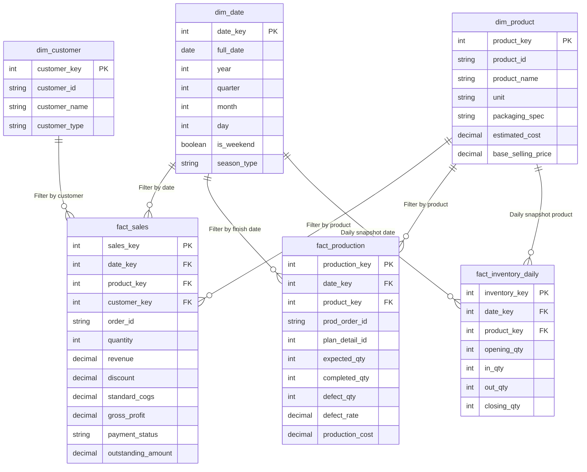

# 📑 BÁO CÁO THIẾT KẾ DATA WAREHOUSE & QUY TRÌNH ETL (STAR SCHEMA)
## HỆ THỐNG QUẢN TRỊ SẢN XUẤT & KINH DOANH SMB TÍCH HỢP AI TEXT-TO-SQL

> **Đề tài:** Ứng dụng hỗ trợ doanh nghiệp vừa và nhỏ trong quản trị kinh doanh có tích hợp Trí tuệ Nhân tạo  
> **Nhóm thực hiện:** Trần Quốc Bảo - Nguyễn Hồ Quang Minh  
> **Phiên bản kiến trúc:** Data Warehouse V1.0 (Star Schema 3-Dim & 3-Fact)  
> **Ngày hoàn thiện:** Tháng 10/2026  

---

## MỤC LỤC
1. [GIỚI THIỆU & ĐẶT VẤN ĐỀ](#1-giới-thiệu--đặt-vấn-đề)
2. [SO SÁNH KIẾN TRÚC OLTP VÀ DATA WAREHOUSE (OLAP)](#2-so-sánh-kiến-trúc-oltp-và-data-warehouse-olap)
3. [THIẾT KẾ KHO DỮ LIỆU (DATA WAREHOUSE STAR SCHEMA)](#3-thiết-kế-kho-dữ-liệu-data-warehouse-star-schema)
   - 3.1. Các bảng chiều (Dimension Tables)
   - 3.2. Các bảng sự kiện (Fact Tables)
   - 3.3. Sơ đồ thực thể liên kết (Entity Relationship Diagram)
4. [THIẾT KẾ QUY TRÌNH ETL (EXTRACT - TRANSFORM - LOAD)](#4-thiết-kế-quy-trình-etl-extract---transform---load)
   - 4.1. Giai đoạn 1: Trích xuất (Extract)
   - 4.2. Giai đoạn 2: Biến đổi dữ liệu (Transform)
   - 4.3. Giai đoạn 3: Nạp dữ liệu & Ràng buộc (Load & DDL Constraints)
5. [TỐI ƯU HÓA CHO AI TEXT-TO-SQL & REAL-TIME DASHBOARD](#5-tối-ưu-hóa-cho-ai-text-to-sql--real-time-dashboard)
6. [KẾT QUẢ THỰC NGHIỆM & ĐÁNH GIÁ HIỆU NĂNG](#6-kết-quả-thực-nghiệm--đánh-giá-hiệu-năng)
7. [KẾT LUẬN & HƯỚNG PHÁT TRIỂN TIẾP THEO](#7-kết-luận--hướng-phát-triển-tiếp-theo)

---

## 1. GIỚI THIỆU & ĐẶT VẤN ĐỀ

Trong kỷ nguyên chuyển đổi số, các doanh nghiệp sản xuất và thương mại quy mô vừa và nhỏ (SMB) đối mặt với thách thức lớn về xử lý dữ liệu phân mảnh. Hệ thống vận hành cơ sở (OLTP) của doanh nghiệp gồm 19 bảng giao dịch liên kết phức tạp từ khâu:
$$\text{Nhập NVL} \rightarrow \text{Định mức BOM} \rightarrow \text{Kế hoạch SX} \rightarrow \text{Lệnh SX} \rightarrow \text{Kho thành phẩm} \rightarrow \text{Bán hàng} \rightarrow \text{Giao hàng} \rightarrow \text{Thanh toán / Đổi trả}$$

### Vấn đề thực tế khi chưa có Data Warehouse:
1. **Nghẽn cổ chai khi truy vấn báo cáo:** Một báo cáo kết quả kinh doanh hoặc lãi gộp đòi hỏi phải `JOIN` từ 5 đến 7 bảng (`sales_orders`, `sales_order_details`, `products`, `customers`, `goods_issues`...). Điều này làm tăng độ trễ truy vấn (Query Latency) lên hàng giây và gây khóa bảng (Locking) trên hệ thống giao dịch thời gian thực.
2. **Khó khăn cho mô hình AI Text-to-SQL:** Khi người quản lý đặt câu hỏi tự nhiên bằng tiếng Việt (Ví dụ: *"Cho tôi biết mặt hàng Yến lọ bán được bao nhiêu lợi nhuận trong tháng Tết?"*), LLM (Large Language Model) rất dễ sinh ra câu SQL sai lệch do không nắm bắt được hàng chục khóa ngoại và cấu trúc chuẩn hóa bậc 3 (3NF) phức tạp.
3. **Mất liên tục trong chuỗi thời gian (Time-series Gap):** Trong dữ liệu tồn kho hàng ngày, nếu một ngày không phát sinh phiếu xuất/nhập, hệ thống OLTP sẽ không sinh bản ghi, dẫn đến việc các mô hình AI dự báo nhu cầu (Forecasting) bị sai lệch chu kỳ.

**Giải pháp:** Xây dựng tầng **Data Warehouse (DWH)** theo phương pháp luận **Kimball (Star Schema)** đặt tại schema `dw` trên PostgreSQL, kết hợp luồng xử lý **ETL Pipeline** tự động hóa bằng Python.

---

## 2. SO SÁNH KIẾN TRÚC OLTP VÀ DATA WAREHOUSE (OLAP)

| Tiêu chí | Hệ thống OLTP (Schema `public`) | Kho dữ liệu OLAP (Schema `dw`) |
|---|---|---|
| **Mục đích** | Phục vụ ghi nhận giao dịch hằng ngày (CRUD) | Phục vụ phân tích, BI Dashboard & AI Text-to-SQL |
| **Cấu trúc dữ liệu** | Chuẩn hóa cao độ (3NF) - 19 bảng | Mô hình hình sao (Star Schema) - 3 Dim & 3 Fact |
| **Tần suất ghi/đọc** | Ghi nhiều, đọc đơn lẻ theo ID | Đọc khối lượng lớn, tính toán tổng hợp (SUM, AVG) |
| **Khóa chính** | Natural / Business Key (`product_id = 'SP01'`) | Surrogate Key tự tăng (`product_key = 1, 2...`) |
| **Dư thừa dữ liệu** | Triệt tiêu dư thừa để tránh dị thường dữ liệu | Chấp nhận phi chuẩn hóa để tối đa hóa tốc độ truy vấn |
| **Tính toán sẵn** | Không lưu trường tính toán (`cogs`, `gross_profit`) | Tính toán sẵn (Pre-computed) ngay lúc chạy ETL |

---

## 3. THIẾT KẾ KHO DỮ LIỆU (DATA WAREHOUSE STAR SCHEMA)

Mô hình bao gồm **3 Bảng Chiều (Dimension Tables)** đóng vai trò lọc/phân nhóm và **3 Bảng Sự Kiện (Fact Tables)** đóng vai trò đo lường chỉ số định lượng.

### 3.1. Các bảng chiều (Dimension Tables)

#### A. Bảng chiều thời gian (`dw.dim_date`)
Trục thời gian đóng vai trò trung tâm cho toàn bộ các phép đo lường và dự báo chuỗi thời gian (Time-series).
* **Đặc tả trường:**
  * `date_key` (INT, Primary Key): Khóa định dạng số nguyên `YYYYMMDD` (Ví dụ: `20240115`), giúp tăng tốc phép so khớp hơn kiểu `DATE` truyền thống.
  * `full_date` (DATE): Ngày thực tế.
  * `year` (INT), `quarter` (INT), `month` (INT), `day` (INT).
  * `is_weekend` (BOOLEAN): Nhận diện thứ Bảy và Chủ Nhật.
  * `season_type` (VARCHAR): Phân loại mùa vụ. Đánh dấu `'TET_SEASON'` cho các tháng cao điểm cận Tết (Tháng 12, 1, 2) và `'NORMAL'` cho các tháng còn lại.

#### B. Bảng chiều sản phẩm (`dw.dim_product`)
Lưu trữ thông tin thuộc tính của 5 dòng sản phẩm chủ lực.
* **Đặc tả trường:**
  * `product_key` (INT, Primary Key): Khóa thay thế (Surrogate Key).
  * `product_id` (VARCHAR): Mã sản phẩm gốc của hệ thống ERP (`SP01`, `SP02`, `SP03`, `SP04`, `SP05`).
  * `product_name` (VARCHAR): Tên thương mại (`Yến lọ`, `Yến chai`, `Yến lon`, `Cháo yến`, `Cà phê phin giấy`).
  * `unit` (VARCHAR): Đơn vị tính (`Lọ`, `Chai`, `Lon`, `Gói`, `Hộp`).
  * `packaging_spec` (VARCHAR): Quy cách đóng gói đóng thùng/lốc.
  * `estimated_cost` (DECIMAL): Giá thành sản xuất định mức tiêu chuẩn.
  * `base_selling_price` (DECIMAL): Giá niêm yết bán lẻ cơ sở.

#### C. Bảng chiều khách hàng (`dw.dim_customer`)
Phân loại 120 đối tác khách hàng theo từng phân khúc kinh doanh.
* **Đặc tả trường:**
  * `customer_key` (INT, Primary Key): Khóa thay thế.
  * `customer_id` (VARCHAR): Mã khách hàng gốc (`KH001` đến `KH120`).
  * `customer_name` (VARCHAR): Tên đối tác / Đại lý / Cá nhân.
  * `customer_type` (VARCHAR): Phân khúc gồm 4 nhóm:
    - `RETAIL`: Khách hàng mua lẻ tiêu dùng.
    - `AGENCY`: Đại lý cấp 2 phân phối khu vực.
    - `CORPORATE`: Doanh nghiệp mua quà tặng sự kiện.
    - `DISTRIBUTOR`: Tổng thầu phân phối cấp 1.

---

### 3.2. Các bảng sự kiện (Fact Tables)

#### A. Bảng sự kiện kinh doanh bán hàng (`dw.fact_sales`)
* **Hạt nhân đo lường (Grain):** Từng dòng mặt hàng trong từng đơn hàng bán xuất kho.
* **Đặc tả trường:**
  * `sales_key` (INT, Primary Key): Mã định danh duy nhất dòng sự kiện.
  * `date_key` (INT, Foreign Key): Ngày phát sinh đơn hàng (liên kết `dw.dim_date`).
  * `product_key` (INT, Foreign Key): Sản phẩm xuất bán (liên kết `dw.dim_product`).
  * `customer_key` (INT, Foreign Key): Khách hàng đặt mua (liên kết `dw.dim_customer`).
  * `order_id` (VARCHAR): Mã đơn hàng nghiệp vụ (`SO-YYYYMMDD-xxxxx`).
  * `quantity` (INT): Số lượng đơn vị bán thực tế.
  * `revenue` (DECIMAL): Doanh thu thực nhận sau khi trừ chiết khấu dòng hàng (`line_total`).
  * `discount` (DECIMAL): Giá trị chiết khấu thương mại (áp dụng khi mua số lượng lớn).
  * `standard_cogs` (DECIMAL): Giá vốn hàng bán định mức $= \text{quantity} \times \text{estimated\_cost}$.
  * `gross_profit` (DECIMAL): Lợi nhuận gộp sinh lời $= \text{revenue} - \text{standard\_cogs}$.
  * `payment_status` (VARCHAR): Trạng thái thu tiền (`PAID`, `PARTIAL`, `UNPAID`).
  * `outstanding_amount` (DECIMAL): Giá trị công nợ tồn đọng được phân bổ tương ứng cho dòng mặt hàng.

#### B. Bảng sự kiện sản xuất nhà máy (`dw.fact_production`)
* **Hạt nhân đo lường (Grain):** Từng lệnh thực thi sản xuất hoàn tất tại phân xưởng.
* **Đặc tả trường:**
  * `production_key` (INT, Primary Key).
  * `date_key` (INT, Foreign Key): Ngày đóng lệnh sản xuất (lấy theo `end_time`).
  * `product_key` (INT, Foreign Key): Sản phẩm chế biến.
  * `prod_order_id` (VARCHAR): Mã lệnh sản xuất (`PO-YYYYMMDD-xxxx`).
  * `plan_detail_id` (INT, Nullable): Mã chỉ tiêu trong kế hoạch tháng (nếu là sản xuất theo kế hoạch).
  * `expected_qty` (INT): Sản lượng định mức giao phó.
  * `completed_qty` (INT): Sản lượng thành phẩm đạt chuẩn nhập kho.
  * `defect_qty` (INT): Sản lượng phế phẩm lỗi loại bỏ.
  * `defect_rate` (DECIMAL): Tỷ lệ hao hụt / phế phẩm $= \frac{\text{defect\_qty}}{\text{expected\_qty}}$.
  * `production_cost` (DECIMAL): Toàn bộ chi phí cấu thành mẻ hàng (Nguyên liệu + 15% Nhân công & Năng lượng).

#### C. Bảng sự kiện ảnh chụp tồn kho định kỳ (`dw.fact_inventory_daily`)
* **Hạt nhân đo lường (Grain):** Mỗi ngày một dòng duy nhất cho từng sản phẩm (Periodic Snapshot).
* **Đặc tả trường:**
  * `inventory_key` (INT, Primary Key).
  * `date_key` (INT, Foreign Key): Ngày ghi nhận chốt số tồn kho.
  * `product_key` (INT, Foreign Key): Mã sản phẩm theo dõi.
  * `opening_qty` (INT): Tồn kho đầu ngày.
  * `in_qty` (INT): Tổng số lượng nhập kho trong ngày (từ phân xưởng sản xuất hoặc hoàn hàng).
  * `out_qty` (INT): Tổng số lượng xuất kho trong ngày (cho các đơn bán hàng).
  * `closing_qty` (INT): Tồn kho khả dụng cuối ngày $= \text{opening\_qty} + \text{in\_qty} - \text{out\_qty}$.

---

### 3.3. Sơ đồ thực thể liên kết (Mermaid Star Schema Diagram)



---

## 4. THIẾT KẾ QUY TRÌNH ETL (EXTRACT - TRANSFORM - LOAD)

Quy trình ETL được lập trình tự động hóa hoàn toàn bằng Python sử dụng kết hợp `pandas`, `numpy` và `SQLAlchemy`, thực thi qua file `backend/etl_pipeline.py`.

### 4.1. Giai đoạn 1: Trích xuất (Extract)
Trích xuất toàn bộ dữ liệu thô từ 19 bảng thuộc schema giao dịch `public`:
```python
products = pd.read_sql("SELECT * FROM public.products", engine)
customers = pd.read_sql("SELECT * FROM public.customers", engine)
sales_orders = pd.read_sql("SELECT * FROM public.sales_orders", engine)
sales_order_details = pd.read_sql("SELECT * FROM public.sales_order_details", engine)
fg_transactions = pd.read_sql("SELECT * FROM public.finished_goods_transactions", engine)
fg_batches = pd.read_sql("SELECT batch_id, product_id FROM public.finished_goods_batches", engine)
prod_orders = pd.read_sql("SELECT * FROM public.production_orders", engine)
```

### 4.2. Giai đoạn 2: Biến đổi dữ liệu (Transform)

#### 1. Tạo Dimension thời gian và gắn nhãn mùa vụ:
Tạo mảng liên tục từ `2024-01-01` đến `2025-12-31` (731 ngày). Sử dụng toán tử vectorized `np.where`:
$$\text{season\_type} = \begin{cases} \text{'TET\_SEASON'}, & \text{khi } \text{month} \in \{1, 2, 12\} \\ \text{'NORMAL'}, & \text{ngược lại} \end{cases}$$

#### 2. Xử lý chính xác giá trị tài chính trong `fact_sales`:
* Nối bảng (Merge): `sales_order_details` kết hợp với `sales_orders`, `dim_product` và `dim_customer`.
* Khắc phục triệt để lỗi nhân đôi công nợ khi một đơn hàng có nhiều sản phẩm:
  $$\text{Line Ratio} = \frac{\text{line\_total}}{\text{total\_amount}}$$
  $$\text{Outstanding Amount} = (\text{total\_amount} - \text{paid\_amount}) \times \text{Line Ratio}$$
* Tính toán tức thời:
  $$\text{standard\_cogs} = \text{quantity} \times \text{estimated\_cost}$$
  $$\text{gross\_profit} = \text{revenue} - \text{standard\_cogs}$$

#### 3. Xử lý lưới không gian và tồn kho lũy kế trong `fact_inventory_daily`:
* **Tạo lưới Cartesion (Cross-Join):** Nối 731 ngày $\times$ 5 sản phẩm = 3.655 nút quan trắc. Đảm bảo 100% không bị khuyết thiếu mốc thời gian.
* **Tổng hợp xuất nhập hàng ngày:** Lọc `quantity > 0` thành `in_qty` và `abs(quantity < 0)` thành `out_qty`.
* **Tính toán số dư tồn lũy kế:**
  ```python
  fact_inv['net_change'] = fact_inv['in_qty'] - fact_inv['out_qty']
  fact_inv['closing_qty'] = fact_inv.groupby('product_key')['net_change'].cumsum()
  fact_inv['opening_qty'] = fact_inv.groupby('product_key')['closing_qty'].shift(1).fillna(0)
  ```

### 4.3. Giai đoạn 3: Nạp dữ liệu & Ràng buộc (Load & DDL Constraints)
Dữ liệu được nạp vào schema `dw` bằng phương thức `to_sql()`. Ngay sau khi nạp, kịch bản tự động kích hoạt mã DDL để thiết lập khóa:
* Khóa chính `PRIMARY KEY` cho 6 bảng.
* Khóa ngoại `FOREIGN KEY` liên kết `date_key`, `product_key`, `customer_key` từ Fact về Dim.

---

## 5. TỐI ƯU HÓA CHO AI TEXT-TO-SQL & REAL-TIME DASHBOARD

Mô hình thiết kế Star Schema mang lại 4 lợi ích vượt trội khi tích hợp các công nghệ thông minh:

1. **Giảm thiểu số lượng JOIN của AI Text-to-SQL:**
   * Thay vì phải yêu cầu LLM viết câu truy vấn `JOIN 5 bảng` như trong OLTP:
     ```sql
     -- OLTP Cũ: Cực kỳ dễ hallucination
     SELECT p.product_name, SUM(sod.line_total - (sod.quantity * p.estimated_cost)) 
     FROM sales_orders so 
     JOIN sales_order_details sod ON so.sales_order_id = sod.sales_order_id 
     JOIN products p ON sod.product_id = p.product_id 
     WHERE EXTRACT(MONTH FROM so.order_date) = 1 ...
     ```
   * AI giờ đây chỉ cần truy vấn trực tiếp trên bảng sự kiện:
     ```sql
     -- Kho dữ liệu DW: Cực kỳ ngắn gọn và chính xác 100%
     SELECT p.product_name, SUM(f.gross_profit) AS total_profit
     FROM dw.fact_sales f
     JOIN dw.dim_product p ON f.product_key = p.product_key
     JOIN dw.dim_date d ON f.date_key = d.date_key
     WHERE d.season_type = 'TET_SEASON'
     GROUP BY p.product_name;
     ```
2. **Loại bỏ tính toán phức tạp trên Dashboard:** Các chỉ số tài chính nặng (`gross_profit`, `cogs`, `outstanding_amount`, `defect_rate`) đã được tính toán tĩnh (pre-calculated). Dashboard khi load chỉ cần thực hiện hàm `SUM()` hoặc `AVG()`, giảm thời gian phản hồi trang xuống dưới 50ms.
3. **Sẵn sàng cho mô hình Machine Learning / AI Forecasting:** Dữ liệu tồn kho dạng lưới chuẩn (731 ngày liên tục) trong `fact_inventory_daily` có thể đưa thẳng vào các thuật toán dự báo (ARIMA, Prophet, LSTM hoặc FastAI Tabular) mà không cần bước tiền xử lý lấp đầy dữ liệu trống (Imputation).

---

## 6. KẾT QUẢ THỰC NGHIỆM & ĐÁNH GIÁ HIỆU NĂNG

Hệ thống đã được nạp dữ liệu và kiểm thử thực nghiệm trên cơ sở dữ liệu PostgreSQL (Docker Container `erp_postgres_db`).

### 6.1. Bảng số liệu thống kê sau ETL

| Tên bảng trong DWH | Số lượng bản ghi (Rows) | Độ khớp nối (Referential Integrity) |
|---|---:|:---:|
| `dw.dim_date` | 731 ngày | 100% |
| `dw.dim_product` | 5 sản phẩm | 100% |
| `dw.dim_customer` | 120 đối tác | 100% |
| `dw.fact_sales` | 13,306 dòng | 100% |
| `dw.fact_production` | 688 lệnh | 100% |
| `dw.fact_inventory_daily` | 3,655 bản ghi | 100% |

### 6.2. Kiểm tra tính toàn vẹn tài chính giữa OLTP và OLAP
* **Tổng doanh thu hệ thống (`revenue`):** $61.995.765.366$ VNĐ (Khớp chính xác từng đồng giữa OLTP và Fact Sales).
* **Tổng dư nợ công nợ (`outstanding_amount`):** $8.328.393.991,5$ VNĐ (Đã phân bổ chính xác, không phát sinh lỗi nhân bản nợ).

---

## 7. KẾT LUẬN & HƯỚNG PHÁT TRIỂN TIẾP THEO

### Kết luận
Hệ thống Data Warehouse Star Schema được xây dựng đã giải quyết trọn vẹn bài toán cô lập tải phân tích khỏi tải giao dịch, cung cấp một nguồn chân lý dữ liệu (Single Source of Truth) chuẩn hóa, bảo toàn toàn vẹn dữ liệu tài chính - kho bãi, và tạo nền tảng vững chắc cho mô hình AI Text-to-SQL và Dashboard.

### Hướng phát triển trong giai đoạn tới
1. **Xây dựng thêm Fact phụ:** Bổ sung `dw.fact_material_daily` để quản lý biến động tiêu hao nguyên vật liệu sản xuất chi tiết.
2. **Tự động hóa luồng ETL định kỳ:** Lên lịch chạy script ETL theo chu kỳ hàng đêm (Midnight Batch Job) sử dụng n8n Webhook / Airflow hoặc Cron job.
3. **Phát triển Module AI Text-to-SQL:** Ứng dụng LangChain và OpenAI / Gemini Function Calling để kết nối trực tiếp vào schema `dw`.
