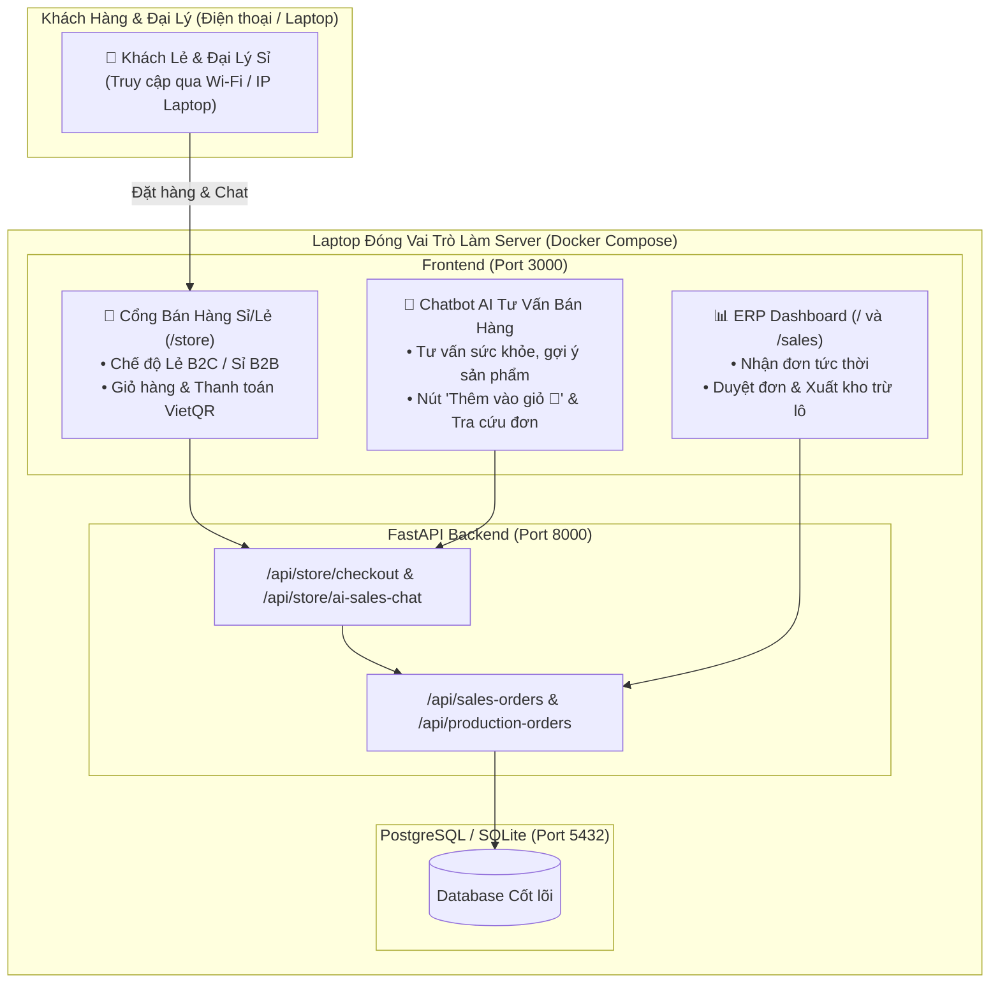

# BÁO CÁO TIẾN ĐỘ THỰC HIỆN ĐỒ ÁN TỐT NGHIỆP
**Đợt báo cáo:** Định kỳ Tháng 10/2026  
**Ngày báo cáo:** 24/10/2026  
**Đề tài:** Hệ thống Quản trị Kinh doanh & Sản xuất Doanh nghiệp Vừa & Nhỏ (SMB) Tích hợp Trí tuệ Nhân tạo (Text-to-SQL, RAG, Chatbot Sales, Data Warehouse ETL & Forecasting)  
**Nhóm sinh viên thực hiện:**
- **Trần Quốc Bảo** — MSSV: [Điền MSSV]
- **Nguyễn Hồ Quang Minh** — MSSV: [Điền MSSV]  
**Giảng viên hướng dẫn:** [Điền tên Giảng viên hướng dẫn]  
**Phiên bản hệ thống hiện tại:** `v1.2.0` (Chuẩn bị nâng cấp `v1.3.0`)

---

## I. MỤC TIÊU & TỔNG QUAN TIẾN ĐỘ

### 1. Bối cảnh Nghiệp vụ
Hệ thống được thiết kế chuyên biệt cho mô hình doanh nghiệp sản xuất và phân phối ngành thực phẩm - đồ uống cao cấp với **05 dòng sản phẩm chủ lực**:
1. Yến lọ chưng đường phèn (70ml)
2. Yến chai nguyên chất (300ml)
3. Yến lon uống liền (190ml)
4. Cháo yến thịt bằm (50g)
5. Cà phê phin giấy Premium (15g)

Chuỗi luồng nghiệp vụ khép kín:
$$\text{Nguyên vật liệu (Tổ yến, Đường, Bao bì)} \longrightarrow \text{Định mức BOM \& Lệnh PO} \longrightarrow \text{Kho Thành phẩm theo Lô} \longrightarrow \text{Đơn bán hàng SO} \longrightarrow \text{Xuất kho 2 bước (DISP)} \longrightarrow \text{Khách hàng \& Công nợ} \longrightarrow \text{Báo cáo BI \& AI Copilot}$$

### 2. Tóm tắt Đánh giá Tiến độ Chung
* **Giai đoạn 1 (Khảo sát, thiết kế hệ thống, chuẩn bị ERP dataset):** Đã hoàn thành 100%.
* **Giai đoạn 2 (Xây dựng CSDL, Backend API, Frontend Dashboard, Tích hợp AI):** Đã hoàn thành 100%.
* **Giai đoạn 3 (Mở rộng Cổng Bán hàng Sỉ/Lẻ, Chatbot VietQR, Dự báo FastAI, Đóng gói Laptop làm Server):** Đã hoàn thiện thiết kế kiến trúc, đang triển khai mã nguồn.
* **Tổng thể tiến độ đồ án:** Đạt khoảng **75% - 80%** khối lượng công việc.

---

## II. KẾT QUẢ ĐÃ HOÀN THÀNH CHI TIẾT (TÍNH ĐẾN 24/10/2026)

### 1. Hạ tầng Dữ liệu & Cơ chế CSDL Kép (Hybrid Database Engine)
- **Thiết kế CSDL chuẩn ERP ([database/schema.sql](file:///d:/Đồ%20Án%20tốt%20nghiệp/database/schema.sql)):** Gồm **15 bảng nghiệp vụ** chuẩn hóa khóa ngoại, ràng buộc toàn vẹn dữ liệu:
  - Danh mục sản phẩm (`products`), nguyên vật liệu (`materials`), công thức định mức (`bom`).
  - Lệnh sản xuất (`production_orders`), chi tiết tiêu hao nguyên vật liệu.
  - Tồn kho thành phẩm quản lý chặt chẽ theo mã Lô (`inventory_lots`).
  - Khách hàng (`customers`), Đơn bán hàng (`sales_orders`), Chi tiết đơn (`sales_order_items`), Phiếu xuất kho (`dispatch_notes`).
- **Cơ chế CSDL Kép (Hybrid DB):**
  - Tự động ưu tiên kết nối **PostgreSQL 15** qua Docker Compose khi khởi chạy server.
  - Tự động fallback sang **SQLite** cục bộ ([database/enterprise_erp.db](file:///d:/Đồ%20Án%20tốt%20nghiệp/database/enterprise_erp.db)) kèm sẵn dữ liệu hạt giống (seed data) nếu PostgreSQL chưa mở. Giúp đảm bảo hệ thống luôn sẵn sàng demo mà không bao giờ gặp lỗi ngắt kết nối.
- **Tự động hóa ETL với n8n ([docker-compose.yml](file:///d:/Đồ%20Án%20tốt%20nghiệp/docker-compose.yml)):**
  - Khởi dựng container n8n (Port 5678) kết nối Data Warehouse.
  - Thiết lập Webhook trung gian xử lý luồng trích xuất dữ liệu, chuẩn hóa ngày tháng và hỗ trợ AI Agent gọi API tool calling.

---

### 2. Backend REST API Toàn Diện (FastAPI — Port 8000)
Mã nguồn tập trung tại [backend/main.py](file:///d:/Đồ%20Án%20tốt%20nghiệp/backend/main.py), cung cấp hệ thống API RESTful đầy đủ:
- **Phân hệ Sản xuất (Production):**
  - `GET /api/production-orders`: Danh sách và trạng thái lệnh sản xuất.
  - `POST /api/production-orders`: Khởi tạo lệnh sản xuất mới (`PENDING`).
  - `POST /api/production-orders/{id}/start`: **Bắt đầu sản xuất** — Hệ thống tự động tính toán và trừ kho Nguyên vật liệu theo định mức BOM.
  - `POST /api/production-orders/{id}/complete`: **Hoàn thành sản xuất** — Hệ thống tự sinh mã Lô (`LOT-PO-2026-xxx`) và nhập kho thành phẩm.
- **Phân hệ Bán hàng & Xuất kho 2 bước (Sales & Inventory):**
  - `GET /api/sales-orders` & `POST /api/sales-orders`: Quản lý và lập đơn bán hàng mới.
  - `POST /api/sales-orders/{id}/dispatch`: **Quy trình xuất kho chuẩn ERP** — Tự động quét kiểm tra số lượng và trừ trực tiếp tồn kho theo từng lô, sinh phiếu xuất `DISP-2026-xxx`.
- **Phân hệ Báo cáo BI Real-time:**
  - `GET /api/dashboard/stats`: Tổng hợp chỉ số Doanh thu tháng, Tồn kho thành phẩm, Tồn kho tổ yến thô, Số lệnh sản xuất đang chạy.
- **Phân hệ AI Assistant Cốt lõi (Text-to-SQL & RAG):**
  - `POST /api/ai/chat`: Nhận diện truy vấn ngôn ngữ tự nhiên từ người dùng, sinh câu lệnh SQL an toàn và truy xuất dữ liệu trả về báo cáo tức thời.

---

### 3. Giao diện Web Dashboard Quản trị Doanh nghiệp (React 19 + Vite — Port 3000)
Triển khai tại thư mục [frontend/](file:///d:/Đồ%20Án%20tốt%20nghiệp/frontend/) theo phương pháp **Test-Driven Development (TDD)**:
- **Design System Độc quyền:** Vanilla CSS Tokens tông màu **Slate & Emerald** sang trọng, hiệu ứng Glassmorphism, Micro-animations, responsive trên mọi kích thước màn hình.
- **Kiến trúc Định tuyến Đa Trang (React Router DOM) gồm 6 phân hệ cốt lõi:**
  1. **Tổng quan BI Dashboard (`/`):** 4 thẻ thống kê KPI real-time + Biểu đồ Recharts sinh động (Biểu đồ miền AreaChart thể hiện xu hướng Doanh thu/Chi phí; Biểu đồ tròn PieChart cơ cấu doanh số 5 nhóm sản phẩm).
  2. **Quản lý Sản xuất (`/production`):** Danh sách Lệnh PO, Modal lập lệnh, nút thao tác 1-click Bắt đầu (trừ NVL) và Hoàn thành (nhập Lô).
  3. **Định mức BOM (`/bom`):** Tra cứu công thức định mức nguyên vật liệu tiêu hao cho từng đơn vị sản phẩm.
  4. **Quản lý Bán hàng & Xuất kho (`/sales`):** Bảng đơn SO, Form lập đơn tính tổng tiền tự động, nút xuất kho trừ lô ERP 2 bước.
  5. **Quản lý Kho Hàng (`/inventory`):** Tab Tồn kho Nguyên vật liệu (kèm cảnh báo mức an toàn tối thiểu) & Tab Tồn kho Thành phẩm theo mã Lô.
  6. **Khách hàng & Công nợ (`/customers`):** Quản lý hồ sơ đối tác, phân loại đại lý/khách lẻ, hạn mức tín dụng và cảnh báo nợ xấu.
- **Trợ lý Toàn cục AI Copilot Drawer:**
  - Panel trượt mượt mà từ cạnh phải màn hình với các nút gợi ý câu hỏi nhanh (Quick Chips) tra cứu trực tiếp từ CSDL Backend.
- **Kiểm thử TDD Tự động:** Bộ test `vitest` và `@testing-library/react` đạt **8/8 bài kiểm thử PASS 100%**. Xác thực toàn diện qua Browser Subagent.

---

## III. BẢNG TỔNG HỢP LỖI PHÁT SINH & GIẢI PHÁP ĐÃ XỬ LÝ
*(Trích xuất từ nhật ký kiểm soát phiên bản [version-tracker.md](file:///d:/Đồ%20Án%20tốt%20nghiệp/version-tracker.md))*

| STT | Vấn đề / Lỗi phát sinh | Mức độ | Nguyên nhân | Giải pháp kỹ thuật đã xử lý |
| :---: | :--- | :---: | :--- | :--- |
| **1** | Lỗi âm tồn kho thành phẩm | Nghiêm trọng | Khi có nhiều đơn hàng xuất kho cùng lúc, số lượng tồn kho bị trừ âm. | Thêm ràng buộc toàn vẹn `CHECK (inventory_count >= 0)` trong DDL Database. |
| **2** | Timeout Webhook n8n (>30s) | Trung bình | AI Chatbot gọi n8n truy xuất toàn bộ Data Warehouse không có bộ đệm. | Tối ưu hóa node truy vấn SQL trong n8n, bổ sung lớp cache giảm thời gian xuống < 3s. |
| **3** | Sai định dạng ngày tháng ETL | Trung bình | File dữ liệu ERP gốc chứa ngày kiểu `DD/MM/YYYY`, gây lỗi khi nạp vào DB. | Bổ sung node `Date & Time` trong luồng n8n để chuẩn hóa toàn bộ về `YYYY-MM-DD`. |
| **4** | Giao diện bất đồng bộ với Backend | Cao | Frontend ban đầu là template Vite mặc định, chưa có định tuyến và form nghiệp vụ. | Thiết kế lại toàn bộ bằng TDD, triển khai 6 trang nghiệp vụ, tích hợp Recharts và AI Drawer. |

---

## IV. KẾ HOẠCH NÂNG CẤP & MỞ RỘNG (GIAI ĐOẠN TIẾP THEO)

Sau phiên thẩm định thiết kế qua quy trình `/grilling`, nhóm đã thống nhất kế hoạch mở rộng các module sau:

### 1. Cổng Bán Hàng Sỉ & Lẻ Tích Hợp (`/store`)
- **Chế độ Bán lẻ (B2C):** Mua theo Lọ / Chai / Lon / Gói theo giá niêm yết.
- **Chế độ Bán sỉ & Đại lý (B2B):** Mua theo Thùng / Lốc, tự động áp dụng chiết khấu đại lý theo số lượng tối thiểu (MOQ) và tích hợp tra cứu hạn mức công nợ.
- **Thanh toán VietQR động:** Tự động sinh mã QR chuẩn Napas chứa số tài khoản, số tiền và nội dung chuyển khoản mã đơn `SO-2026-xxxx`.

### 2. Trợ lý Chatbot AI Hỗ Trợ Bán Hàng (Conversational Commerce)
- Tư vấn công dụng sản phẩm (người già, trẻ nhỏ, phụ nữ mang thai, người ăn kiêng).
- Trực tiếp tạo nút **"Thêm vào giỏ hàng ngay 🛒"** trong khung chat khi khách yêu cầu.
- Tra cứu trạng thái đơn hàng theo mã đơn trực tiếp từ CSDL.

### 3. Đóng Gói Toàn Bộ Hệ Thống Chạy Trên Laptop (Laptop làm Server)
- Hoàn thiện file [docker-compose.yml](file:///d:/Đồ%20Án%20tốt%20nghiệp/docker-compose.yml) chứa đầy đủ 4 dịch vụ:
  1. `postgres` (Cơ sở dữ liệu)
  2. `n8n` (Tự động hóa ETL)
  3. `backend` (FastAPI Server)
  4. `frontend` (React Web Storefront + Dashboard)
- Chỉ cần khởi chạy: `docker compose up -d --build`. Các thiết bị di động kết nối cùng mạng Wi-Fi có thể truy cập `http://<IP_LAPTOP>:3000/store` để demo trực tiếp cho Giảng viên.

### 4. Tích hợp Mô hình Dự báo FastAI
- Huấn luyện mô hình Deep Learning/Machine Learning với thư viện FastAI trên tập dữ liệu ERP Dataset để dự báo nhu cầu bán hàng và kế hoạch cung ứng nguyên vật liệu.

---

## V. PHÂN CÔNG NHIỆM VỤ THỰC HIỆN TRONG NHÓM

| Thành viên | Trách nhiệm chính | Tiến độ đạt được | Nhiệm vụ đợt tới |
| :--- | :--- | :---: | :--- |
| **Trần Quốc Bảo** | - Thiết kế DDL CSDL ERP & Hybrid DB Engine - Xây dựng Backend FastAPI (Sản xuất, Kho, Bán hàng) - Xây dựng Module Text-to-SQL & n8n Webhook | **80%** | - Xây dựng API Checkout & Chatbot Bán hàng `/api/store/*` - Cấu hình mạng Docker Compose Laptop Server |
| **Nguyễn Hồ Quang Minh** | - Thiết kế UI/UX & Design System Slate-Emerald - Xây dựng 6 phân hệ Web Dashboard React Vite - Tích hợp biểu đồ Recharts, AI Copilot Drawer & TDD test | **80%** | - Triển khai giao diện Cổng Bán Hàng Sỉ/Lẻ `/store` - Tích hợp thanh toán VietQR & Widget Chatbot bán hàng - Nghiệm thu demo thiết bị di động |

---

## VI. KẾT LUẬN & ĐỀ XUẤT Ý KIẾN VỚI GIẢNG VIÊN HƯỚNG DẪN

1. **Đánh giá chung:** Hệ thống đã hoàn thành trọn vẹn khung sườn kỹ thuật nền tảng bao gồm cả CSDL, Backend nghiệp vụ, Frontend Dashboard quản trị và tích hợp AI ban đầu. Tiến độ hiện tại hoàn toàn đúng lộ trình đề ra của đồ án.
2. **Kế hoạch buổi gặp hướng dẫn tiếp theo:**
   - Báo cáo và demo trực tiếp các luồng Lệnh sản xuất, Xuất kho trừ lô ERP 2 bước và AI Copilot trên máy tính.
   - Xin ý kiến đóng góp của Thầy/Cô về cấu trúc phân hệ Cổng Bán hàng Sỉ/Lẻ (`/store`) và phương án sinh mã VietQR.

---
*Báo cáo được khởi tạo tự động dựa trên nhật ký phiên bản thực tế của đồ án tốt nghiệp.*
