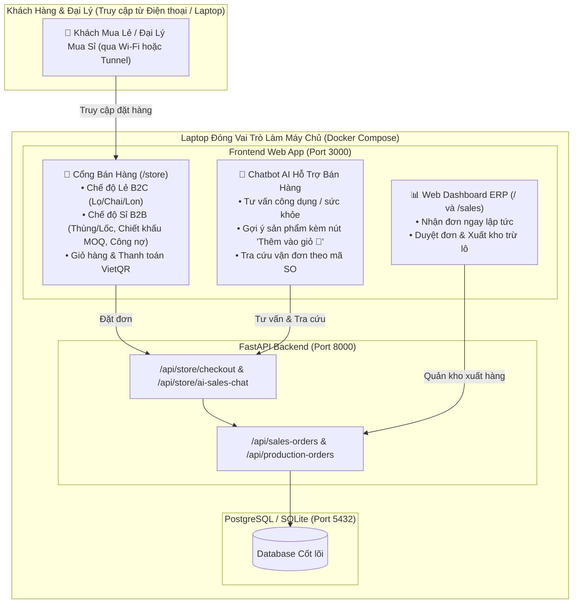

# BÁO CÁO TOÀN DIỆN TIẾN ĐỘ DỰ ÁN & KẾ HOẠCH NÂNG CẤP HỆ THỐNG
**Đồ án tốt nghiệp:** Hệ thống Quản trị Kinh doanh & Sản xuất SMB Tích hợp AI  
**Nhóm thực hiện:** Trần Quốc Bảo — Nguyễn Hồ Quang Minh  
**Thời gian cập nhật:** 14/10/2026 (Phiên bản v1.2.0)  

---

## 📌 1. Bối cảnh & Nghiệp vụ Cốt lõi Doanh nghiệp

Hệ thống phục vụ cho doanh nghiệp sản xuất và phân phối **05 dòng sản phẩm chính**:
1. **Yến lọ chưng đường phèn (70ml)**
2. **Yến chai nguyên chất (300ml)**
3. **Yến lon uống liền (190ml)**
4. **Cháo yến thịt bằm (50g)**
5. **Cà phê phin giấy Premium (15g)**

### Chuỗi luồng nghiệp vụ khép kín:
$$\text{Nguyên vật liệu (Tổ yến, đường, bao bì)} \longrightarrow \text{Sản xuất (Định mức BOM \& Lệnh PO)} \longrightarrow \text{Nhập kho Thành phẩm theo Lô} \longrightarrow \text{Bán hàng (Đơn SO)} \longrightarrow \text{Xuất kho 2 bước (Phiếu DISP)} \longrightarrow \text{Khách hàng \& Công nợ} \longrightarrow \text{Thanh toán / Báo cáo BI}$$

---

## ✅ 2. Những Điều Đã Hoàn Thành 100% (Tính Đến Hiện Tại)

### A. Hạ tầng Cơ sở Dữ liệu & Cơ chế Hybrid DB
- **Thiết kế DDL CSDL chuẩn ERP ([database/schema.sql](database/schema.sql)):** Bao gồm 15 bảng nghiệp vụ liên kết chặt chẽ (Danh mục sản phẩm, nguyên vật liệu, định mức BOM, lệnh sản xuất, kho thành phẩm theo lô, khách hàng, đơn bán hàng, phiếu xuất kho, thanh toán, công nợ).
- **Cơ chế CSDL Kép (Hybrid DB Engine):** 
  - Hệ thống tự động ưu tiên kết nối **PostgreSQL** trong môi trường Docker Container.
  - Tự động fallback sang **SQLite** cục bộ ([database/enterprise_erp.db](database/enterprise_erp.db)) kèm sẵn dữ liệu mẫu (seed data) nếu PostgreSQL chưa mở. Đảm bảo toàn bộ hệ thống luôn khởi chạy được ngay lập tức mà không bao giờ gặp lỗi gián đoạn.

---

### B. Hệ thống Backend REST API (FastAPI — Port 8000)
Toàn bộ mã nguồn API tập trung tại [backend/main.py](backend/main.py), bao gồm:
1. **Phân hệ Sản xuất (Production):**
   - `GET /api/products`: Danh mục 5 dòng sản phẩm, quy cách đóng gói và giá bán.
   - `GET /api/bom/{product_id}`: Định mức tiêu hao nguyên vật liệu (BOM) chi tiết cho từng sản phẩm.
   - `GET /api/materials`: Danh mục và số lượng tồn kho nguyên vật liệu đầu vào.
   - `GET /api/production-orders` & `POST /api/production-orders`: Quản lý và lập Lệnh sản xuất mới (`PENDING`).
   - `POST /api/production-orders/{id}/start`: **Bắt đầu sản xuất** — tự động tính toán và trừ tồn kho Nguyên vật liệu trong DB theo đúng định mức BOM.
   - `POST /api/production-orders/{id}/complete`: **Hoàn thành sản xuất** — tự động nhập số lượng thành phẩm vào kho theo mã Lô (`LOT-PO-2026-xxx`).
2. **Phân hệ Bán hàng & Kho (Sales & Inventory):**
   - `GET /api/customers`: Danh bạ khách hàng, phân loại đại lý/khách lẻ, hạn mức tín dụng và công nợ hiện tại.
   - `GET /api/inventory/finished-goods`: Bảng tồn kho thành phẩm quản lý chi tiết theo mã Lô (Lot number) và ngày sản xuất.
   - `GET /api/sales-orders` & `POST /api/sales-orders`: Quản lý và tạo mới Đơn bán hàng (`NEW`).
   - `POST /api/sales-orders/{id}/dispatch`: **Quy trình Xuất kho chuẩn ERP 2 bước** — tự động quét kiểm tra và trừ tồn kho thành phẩm theo từng lô, sinh mã phiếu xuất `DISP-2026-xxx`.
3. **Phân hệ Báo cáo BI Real-time:**
   - `GET /api/dashboard/stats`: Tổng hợp số liệu tức thời về Doanh thu tháng, Tồn kho thành phẩm, Tổ yến thô và số Lệnh sản xuất đang chạy.
4. **Phân hệ AI Assistant (Text-to-SQL & RAG Core):**
   - `POST /api/ai/chat`: Trợ lý AI kết nối trực tiếp CSDL cốt lõi, trả lời ngôn ngữ tự nhiên về số liệu tồn kho, định mức BOM, sản phẩm bán chạy và doanh thu thời gian thực.

---

### C. Giao diện Web Dashboard Quản trị (React 19 + Vite — Port 3000)
Xây dựng theo phương pháp **Test-Driven Development (TDD)** với bộ test Vitest đạt **8/8 bài kiểm thử tự động PASS 100%**:
1. **Hệ thống Design System Độc quyền ([frontend/src/index.css](frontend/src/index.css)):**
   - Bộ Design Tokens tông màu **Slate & Emerald** sang trọng, chuẩn ngành chế biến thực phẩm yến sào & cà phê cao cấp.
   - Hiệu ứng **Glassmorphism**, font chữ hiện đại *Plus Jakarta Sans*, micro-animations phản hồi mượt mà.
2. **Kiến trúc Định tuyến Đa Trang (React Router DOM) gồm 6 phân hệ:**
   - **Tổng quan ([/](frontend/src/pages/Dashboard.jsx)):** 4 thẻ chỉ số KPI real-time + Biểu đồ Recharts sinh động (Biểu đồ miền AreaChart thể hiện xu hướng Doanh thu & Chi phí 6 tháng; Biểu đồ tròn PieChart thể hiện tỷ trọng doanh số 5 dòng sản phẩm).
   - **Quản lý Sản xuất ([/production](frontend/src/pages/Production.jsx)):** Bảng lệnh PO, bộ lọc trạng thái, Form Modal tạo lệnh, các nút bấm thao tác 1-click "Bắt đầu (Xuất NVL)" và "Nhập kho Lô".
   - **Định mức BOM ([/bom](frontend/src/pages/BOM.jsx)):** Tra cứu nhanh công thức định mức nguyên vật liệu cho từng sản phẩm.
   - **Quản lý Bán hàng & Xuất kho ([/sales](frontend/src/pages/Sales.jsx)):** Danh sách đơn SO, Form Modal lập đơn tự tính tổng tiền, nút "Xuất kho (Trừ lô)" 2 bước chuẩn ERP.
   - **Quản lý Kho Hàng ([/inventory](frontend/src/pages/Inventory.jsx)):** Tab Tồn kho Nguyên vật liệu (kèm cảnh báo tồn tối thiểu) & Tab Tồn kho Thành phẩm theo mã Lô.
   - **Khách hàng & Công nợ ([/customers](frontend/src/pages/Customers.jsx)):** Theo dõi đối tác, hạn mức tín dụng và cảnh báo rủi ro vượt công nợ.
3. **Trợ lý Toàn cục AI Copilot Drawer ([frontend/src/components/AICopilotDrawer.jsx](frontend/src/components/AICopilotDrawer.jsx)):**
   - Nút nổi góc phải dưới màn hình.
   - Bảng điều khiển dạng Drawer trượt mượt mà từ cạnh phải màn hình với các nút gợi ý câu hỏi nhanh (Quick Chips) tra cứu trực tiếp từ Backend CSDL mà không làm gián đoạn công việc của người dùng.
4. **Đã Nghiệm thu Trực tiếp qua Browser Subagent:**
   - Cả 6 trang và AI Assistant hoạt động đồng bộ với Backend FastAPI đang chạy thực tế trên máy.

---

## 🎯 3. Kế hoạch Nâng cấp Mới: Cổng Bán Hàng Sỉ/Lẻ, Chatbot Mua Bán & Deploy Laptop Máy Chủ

Dựa trên kết quả phỏng vấn chuyên sâu qua quy trình `/grilling`, hệ thống đã chốt giải pháp triển khai giai đoạn tiếp theo để bàn thảo thống nhất trong nhóm:



### 1️⃣ Cổng Bán Hàng Sỉ & Lẻ Tích Hợp (`/store`)
- **Tích hợp vào cùng ứng dụng:** Truy cập qua URL `/store` hoặc nút chuyển đổi từ thanh điều hướng Dashboard.
- **Cơ chế 2 chế độ Bán Sỉ & Bán Lẻ:**
  - **Khách mua lẻ (B2C):** Mua theo Lọ / Chai / Lon / Gói theo giá bán lẻ niêm yết.
  - **Khách mua sỉ & Đại lý (B2B):** Mua theo Thùng / Lốc, tự động áp dụng giá chiết khấu đại lý theo số lượng đặt tối thiểu (MOQ), cho phép nhập SĐT hoặc Mã Đại Lý để hệ thống nhận diện từ bảng `customers`, áp dụng hạn mức công nợ và chiết khấu riêng theo hợp đồng.

### 2️⃣ Trợ lý Chatbot AI Hỗ Trợ Mua Bán (Conversational Commerce)
- **Tư vấn chuyên sâu:** Giải đáp công dụng (ví dụ: người già, phụ nữ mang thai, người ăn kiêng dùng loại nào?), chính sách làm đại lý phân phối, quy cách đóng gói.
- **Thêm vào giỏ hàng trực tiếp qua Chat:** Khi khách chat yêu cầu (ví dụ: *"Giao cho tôi 2 thùng yến lon và 3 hộp cà phê"*), Chatbot tự động trả lời kèm thẻ sản phẩm và nút bấm **"Thêm vào giỏ hàng ngay 🛒"**.
- **Tra cứu trạng thái đơn hàng:** Khách chỉ cần nhắn mã đơn (ví dụ `SO-2026-xxxx`), AI tra cứu ngay trong CSDL và phản hồi tiến độ (Đã duyệt, Đang xuất kho, Đã giao).

### 3️⃣ Thanh Toán Đa Dạng & Tự Động Tạo Mã VietQR
- **Chuyển khoản ngân hàng VietQR:** Tự động sinh ảnh mã QR chuẩn Napas chứa chính xác số tài khoản, số tiền đơn hàng và nội dung chuyển khoản là mã đơn `SO-2026-xxxx`. Khách chỉ cần mở App ngân hàng quét là xong.
- **Tiền mặt khi nhận hàng (COD)**.
- **Ghi nợ công nợ B2B:** Dành riêng cho khách sỉ / đại lý đã ký hợp đồng.

### 4️⃣ Liên Kết Tức Thời với Dashboard ERP Hiện Tại
- Ngay khi khách đặt đơn trên Cổng Bán Hàng, đơn hàng lập tức được ghi vào bảng `sales_orders` với trạng thái `NEW` và nhãn kênh bán (`STOREFRONT_RETAIL` hoặc `STOREFRONT_WHOLESALE`).
- Màn hình Quản lý Bán hàng (`/sales`) của Dashboard hiển thị ngay đơn hàng mới.
- Quản kho bấm nút **"Xuất kho (Trừ lô)"** để trừ tồn kho thành phẩm theo lô ERP 2 bước (`DISP-2026-xxx`).
- Số liệu doanh thu trên Dashboard tự động nhảy số theo thời gian thực.

### 5️⃣ Giải Pháp Triển Khai Laptop Làm Máy Chủ (Docker Compose)
- Đóng gói toàn bộ hệ thống gồm 4 thành phần trong [docker-compose.yml](docker-compose.yml):
  1. `postgres`: Cơ sở dữ liệu nghiệp vụ.
  2. `n8n`: Xử lý tự động hóa ETL và Webhook.
  3. `backend`: Server FastAPI (Port 8000).
  4. `frontend`: Cổng bán hàng & Dashboard ERP (Port 3000 / 80).
- **Khởi chạy cực kỳ đơn giản:** Chỉ cần chạy lệnh:
  ```bash
  docker compose up -d --build
  ```
- Toàn bộ laptop đóng vai trò là một máy chủ nội bộ. Các thiết bị khác (điện thoại của khách, máy tính bảng của nhân viên bán hàng) cùng kết nối Wi-Fi có thể truy cập ngay qua địa chỉ IP: `http://<IP_CỦA_LAPTOP>:3000/store`.

---

## 📋 4. Các Bước Triển Khai Tiếp Theo (Next Steps để Bàn với Nhóm)

1. **Giai đoạn 1 — Backend & Chatbot API:**
   - Xây dựng endpoint đặt hàng `/api/store/checkout`.
   - Xây dựng endpoint chatbot bán hàng `/api/store/ai-sales-chat` hỗ trợ tư vấn và nhận diện sản phẩm thêm vào giỏ.
2. **Giai đoạn 2 — Giao diện Cổng Bán Hàng & Giỏ Hàng (`/store`):**
   - Thiết kế giao diện Catalog sản phẩm chuẩn thương mại điện tử với bộ chuyển chế độ Sỉ/Lẻ.
   - Giỏ hàng trượt (Cart Drawer) và Modal thanh toán VietQR động.
   - Widget Chatbot AI bán hàng góc phải màn hình.
3. **Giai đoạn 3 — Đóng Gói Docker Compose Chạy Laptop:**
   - Tạo `backend/Dockerfile` và `frontend/Dockerfile`.
   - Cấu hình mạng Docker trong `docker-compose.yml` để 1-click chạy được ngay trên Laptop.
4. **Giai đoạn 4 — Kiểm Thử & Nghiệm Thu:**
   - Viết test tự động TDD cho các luồng đặt hàng mới.
   - Dùng điện thoại thực tế kết nối vào Laptop qua IP Wi-Fi để thử đặt hàng và xem đơn hàng nhảy số real-time trên Dashboard ERP.

---
*Báo cáo được khởi tạo tự động phục vụ thảo luận nhóm và lưu trữ tiến độ đồ án tốt nghiệp.*
