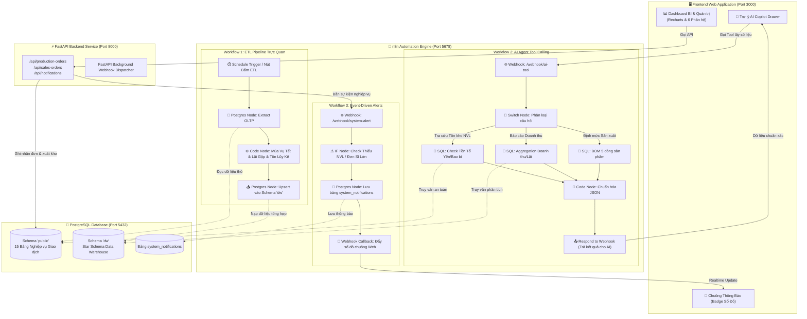

# KẾ HOẠCH TỔNG THỂ: TÍCH HỢP n8n AUTOMATION ENGINE & KỊCH BẢN DEMO GIẢNG VIÊN
**Đồ án tốt nghiệp:** Hệ thống Quản trị Kinh doanh & Sản xuất SMB Tích hợp AI  
**Nhóm thực hiện:** Trần Quốc Bảo — Nguyễn Hồ Quang Minh  
**Thời gian lập kế hoạch:** 20/10/2026 (Phiên bản v1.3.0 - Milestone n8n Integration)

---

## 📌 1. Bối cảnh & Tầm quan trọng của n8n trong Đồ án Tốt nghiệp

Căn cứ theo tài liệu quy chuẩn cốt lõi của đồ án:
* **Nguyên tắc số 2 ([gemini-code-1791609273319.md](gemini-code-1791609273319.md)):** Bắt buộc sử dụng công cụ **n8n** đóng vai trò làm *"chân tay"* thực thi. n8n đảm nhận việc xử lý luồng dữ liệu BI (Extract - Transform - Load) tự động đẩy về kho dữ liệu Star Schema (`dw`), đồng thời cung cấp các Webhook để Chatbot AI có thể gọi hàm (Tool Calling) chọc vào SQL/ERP lấy số liệu thời gian thực mà không vi phạm nguyên tắc bảo mật.
* **Mục tiêu buổi demo với Giảng viên:** 
  1. Thuyết phục Hội đồng bằng sự **trực quan** (Visual Workflow): Giảng viên nhìn thấy từng block dữ liệu chạy sáng đèn trên n8n Canvas thay vì một "hộp đen" code ngầm.
  2. Thể hiện tính **tự động hóa khép kín**: Người dùng thao tác trên Web $\rightarrow$ n8n tiếp nhận $\rightarrow$ phân tích dữ liệu $\rightarrow$ cập nhật Kho DW và bắn cảnh báo về Chuông thông báo trên Dashboard.

---

## 🏗️ 2. Sơ đồ Kiến trúc Tích hợp n8n Toàn diện



---

## ⚙️ 3. Đặc tả Kỹ thuật Chi tiết 3 Workflows n8n

### 3.1. Workflow 1: Visual ETL Pipeline (OLTP $\rightarrow$ Star Schema `dw`)
* **Trigger:** Chạy định kỳ lúc 00:00 hàng ngày (Schedule Trigger) HOẶC kích hoạt thủ công qua Webhook (`POST /webhook/trigger-etl`).
* **Các bước thực thi trực quan trên Canvas:**
  1. `Postgres Node (Extract)`: Thực hiện truy vấn trích xuất dữ liệu mới từ các bảng `sales_orders`, `sales_order_details`, `production_orders`, `materials`.
  2. `Code Node (Transform)`:
     - Gắn cờ mùa vụ: Tháng 1, 2, 12 gán nhãn `TET_SEASON` (Mùa vụ Tết ngành Yến sào), các tháng khác gán `NORMAL`.
     - Tính toán tài chính: Phân bổ tỷ lệ dòng hàng nhằm tránh nhân đôi công nợ (`Line Ratio`), tính lãi gộp tức thời $\text{gross\_profit} = \text{revenue} - \text{standard\_cogs}$.
     - Tính toán tồn kho lũy kế: Thực hiện phép tính cộng dồn `cumsum()` nhập trừ xuất để tạo số liệu cho `dw.fact_inventory_daily`.
  3. `Postgres Node (Load)`: Nạp dữ liệu vào Star Schema schema `dw` (bảng `dw.fact_sales`, `dw.fact_production`, `dw.fact_inventory_daily`).

---

### 3.2. Workflow 2: AI Agent Tool Calling Middleware
* **Trigger:** Webhook đón nhận yêu cầu từ Backend / AI Copilot Drawer: `POST /webhook/ai-tool`.
* **Payload đầu vào mẫu:**
  ```json
  {
    "action": "QUERY_INVENTORY",
    "parameters": { "material_code": "NVL-YEN-01" },
    "user_query": "Kiểm tra tồn kho tổ yến tinh chế hiện tại"
  }
  ```
* **Các bước thực thi:**
  1. `Switch Node (Router)`: Đọc trường `action` để rẽ thành 3 nhánh logic chuyên biệt:
     - Nhánh 1: `QUERY_INVENTORY` (Kiểm tra kho).
     - Nhánh 2: `REVENUE_ANALYTICS` (Báo cáo doanh thu & lãi gộp từ schema `dw`).
     - Nhánh 3: `BOM_LOOKUP` (Tra cứu công thức định mức sản xuất).
  2. `Postgres Query Nodes`: Thực hiện các câu lệnh SQL tham số hóa (Parameterized Query) an toàn, tránh SQL Injection.
  3. `Respond to Webhook Node`: Trả về JSON có cấu trúc để AI Copilot tổng hợp lời giải thích tự nhiên cho người dùng.

---

### 3.3. Workflow 3: Event-Driven System Alerts & Chuông Thông Báo
* **Trigger:** Webhook từ FastAPI: `POST /webhook/system-alert`.
* **Kịch bản thực chiến:**
  - **Sự kiện 1 (Thiếu NVL khi lập lệnh PO):** Khi nhân viên bấm "Bắt đầu sản xuất", nếu số lượng Tổ yến thô hoặc Đường phèn tồn kho sau khi trừ định mức bị $< 500$, Backend lập tức bắn Webhook sang n8n.
  - **Sự kiện 2 (Đơn hàng B2B giá trị lớn):** Khi có đơn sỉ trị giá $> 20.000.000$ VNĐ từ Cổng bán hàng, n8n tiếp nhận và phân loại độ ưu tiên `HIGH_PRIORITY`.
* **Hành động của n8n:**
  1. Ghi một bản ghi mới vào bảng `system_notifications` trong PostgreSQL với các trường: `title`, `message`, `severity` (`CRITICAL` / `WARNING` / `INFO`), `created_at`.
  2. Trả mã thành công về cho Backend để cập nhật chỉ số badge chuông trên Web Dashboard.

---

## 📦 4. Giải pháp Đóng Gói Tự Động Hóa (Docker Compose Auto-Import)

Để buổi bảo vệ và demo diễn ra 100% trơn tru, không phải bấm tạo từng node thủ công:

1. **Cấu trúc lưu trữ trong Git Repository:**
   ```
   d:/Đồ Án tốt nghiệp/
   ├── n8n/
   │   ├── workflows/
   │   │   ├── 01_etl_star_schema.json       # Workflow ETL trực quan
   │   │   ├── 02_ai_tool_calling.json        # Workflow Tool Calling cho AI
   │   │   └── 03_event_driven_alerts.json    # Workflow Cảnh báo hệ thống
   │   └── README.md                          # Hướng dẫn cấu hình n8n credentials
   ├── docker-compose.yml                     # Cấu hình n8n + postgres + backend + frontend
   ```

2. **Cấu hình Docker Compose tự động nạp Workflows khi Start:**
   Gắn Volume `./n8n/workflows:/backup/workflows` và cấu hình command tự động chạy lệnh `n8n import:workflow` để khi sinh viên gõ `docker compose up -d`, toàn bộ 3 workflow đã sẵn sàng ở trạng thái **Active**.

---

## 🎬 5. Kịch Bản Demo Trực Tiếp Với Giảng Viên (10 Phút)

| Thời gian | Phân đoạn | Thao tác trên màn hình | Lời thoại thuyết minh hướng tới Giảng viên |
| :---: | :--- | :--- | :--- |
| **00:00 - 02:00** | **1. Giới thiệu kiến trúc tổng thể** | Chiếu Slide sơ đồ Mermaid và mở 2 cửa sổ song song: Trái là Web Dashboard, Phải là Canvas n8n. | *"Thưa Thầy/Cô, hệ thống của nhóm em tuân thủ nghiêm ngặt mô hình BI & AI chuẩn doanh nghiệp. Backend FastAPI xử lý nghiệp vụ, PostgreSQL lưu trữ dữ liệu, và n8n đóng vai trò là 'hệ thần kinh tự động hóa', vừa làm ETL đổ về Data Warehouse, vừa làm Tool Calling cho AI."* |
| **02:00 - 05:00** | **2. Demo Luồng ETL trực quan** | Trên Web bấm nút "Đồng bộ Data Warehouse", lập tức chuyển sang tab n8n thấy các node sáng đèn xanh chạy từ Extract $\rightarrow$ Transform $\rightarrow$ Load. Sau đó quay lại Dashboard thấy biểu đồ Recharts cập nhật số liệu mới. | *"Thay vì chạy một script ngầm không rõ tiến độ, n8n hiển thị tường minh luồng biến đổi dữ liệu: tính toán mùa vụ Tết, phân bổ công nợ tránh nhân đôi và nạp trực tiếp vào Star Schema dw.fact_sales để phục vụ báo cáo BI tức thì."* |
| **05:00 - 07:30** | **3. Demo AI Copilot gọi Tool n8n** | Mở AI Copilot Drawer trên Web, gõ câu hỏi: *"Kiểm tra tồn kho Tổ yến tinh chế hiện tại"*. Trên n8n, thấy Webhook Node nhận request và Switch Node kích hoạt nhánh SQL. AI nhận kết quả và trả lời ngay. | *"Thưa Thầy/Cô, AI Agent không truy cập tự do vào Database mà thông qua Tool Server n8n. n8n kiểm soát chặt chẽ các câu lệnh SQL, đảm bảo tính bảo mật và toàn vẹn dữ liệu cho doanh nghiệp."* |
| **07:30 - 09:30** | **4. Demo Cảnh báo Tự động & Chuông Thông báo** | Thao tác trên trang `/production`, bấm "Bắt đầu sản xuất" một lệnh PO số lượng lớn làm cạn Tổ yến. Ngay lập tức chuông thông báo trên Web rung và nhảy số đỏ: *"CẢNH BÁO: Tổ yến dưới ngưỡng an toàn!"*. | *"Khi xảy ra biến động bất thường về kho hoặc đơn hàng lớn, n8n tiếp nhận sự kiện qua Webhook, phân loại mức độ nghiêm trọng và đẩy ngay cảnh báo lên Notification Center của cấp quản lý."* |
| **09:30 - 10:00** | **5. Kết luận & Mời chấm điểm** | Tóm tắt kết quả kiểm thử TDD (12/12 tests PASS) và cơ chế Hybrid DB sẵn sàng chạy offline. | *"Toàn bộ hệ thống đã được kiểm thử tự động TDD và đóng gói Docker 1-click có thể chạy ngay trên máy tính xách tay cá nhân."* |

---

## 🛡️ 6. Bộ Câu Hỏi Phản Biện & Câu Trả Lời Mẫu Chuẩn Chỉnh

#### ❓ Câu hỏi 1: *"Tại sao nhóm lại dùng n8n mà không viết thẳng code Python/Celery hoặc dùng Airflow?"*
> **Trả lời:**  
> *"Dạ thưa Thầy/Cô, Apache Airflow rất mạnh nhưng đòi hỏi hạ tầng tài nguyên rất lớn (cần Redis, Celery workers, Scheduler riêng) không phù hợp với phân khúc doanh nghiệp vừa và nhỏ (SMB) mà đề tài hướng tới. n8n vừa cung cấp giao diện trực quan Low-code/No-code giúp bộ phận vận hành dễ dàng theo dõi lỗi, vừa hỗ trợ Webhook thời gian thực phản hồi trong vài mili-giây, rất tối ưu khi đóng vai trò làm Tool Calling cho AI Agent so với cơ chế Batch-oriented của Airflow."*

#### ❓ Câu hỏi 2: *"Nếu n8n xử lý dữ liệu lớn (Big Data) thì có bị nghẽn (bottleneck) không?"*
> **Trả lời:**  
> *"Dạ thưa Thầy/Cô, trong thiết kế của nhóm em, n8n chỉ đóng vai trò Điều phối (Orchestrator). Đối với các tác vụ tính toán nặng hoặc tập dữ liệu hàng triệu dòng, n8n sử dụng Database Nodes để đẩy tải tính toán (Push-down computation) trực tiếp cho PostgreSQL Engine xử lý bằng các câu lệnh SQL tối ưu hoặc kích hoạt batch pipeline, thay vì kéo toàn bộ dữ liệu thô vào bộ nhớ Node.js của n8n, do đó hệ thống luôn hoạt động ổn định và không bị tràn RAM."*

#### ❓ Câu hỏi 3: *"Bảo mật Webhook giữa Web/Backend và n8n được đảm bảo như thế nào?"*
> **Trả lời:**  
> *"Dạ thưa Thầy/Cô, toàn bộ các Webhook n8n đều nằm trong mạng nội bộ Docker Network cô lập (không public ra ngoài Internet). Đối với các Webhook nhận lệnh từ Backend hoặc AI Copilot, hệ thống cấu hình Header Authentication sử dụng API Secret Key để xác thực request hợp lệ trước khi thực thi truy vấn cơ sở dữ liệu."*

---

## 📋 7. Danh Mục Công Việc Triển Khai Tiếp Theo (Action Items)

- [ ] **Bước 1:** Tạo thư mục `n8n/workflows/` và xuất 3 file JSON workflow chuẩn hóa.
- [ ] **Bước 2:** Bổ sung bảng `system_notifications` vào `database/schema.sql` và `database/seed.sql`.
- [ ] **Bước 3:** Thêm component `NotificationBell` (Chuông thông báo kèm badge đỏ) vào thanh Navigation của Frontend React.
- [ ] **Bước 4:** Bổ sung endpoint phát sự kiện Webhook trong `backend/main.py` khi trừ kho NVL và khi tạo đơn hàng mới.
- [ ] **Bước 5:** Chạy thử nghiệm đồng bộ toàn bộ luồng bằng kịch bản 10 phút để nhóm tập dượt thuyết trình.
